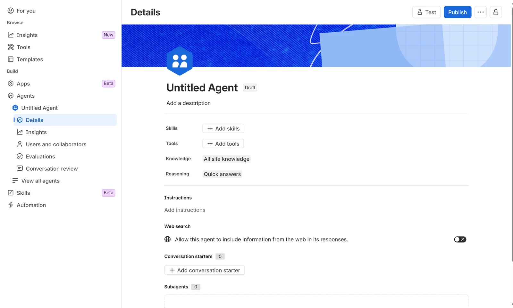

*Most first agents are general assistants nobody asked for. The ones that get used do one job well.*

To create a Rovo agent, open Rovo Studio, select **Agents**, then **Create an agent**. Describe what you want in plain language and the builder drafts a name, instructions and conversation starters, or select **Start from blank** and fill in each part yourself. You can also start from Rovo Chat with **Create agent**, or from the assignee picker on a Jira work item.

The clicks take minutes. Whether anyone uses the agent a month later is decided before that, by how narrow its job is, and after it, by how you test it with real questions.

## Pick one narrow job

A good first agent answers one kind of question, or does one kind of task, for one audience. Three tests help:

- **It happens every week.** Someone asks it, or does it by hand, often enough that saving the time matters.
- **The answer lives in content you control.** A Confluence space, a set of Jira work items, a folder of policies.
- **You can tell a right answer from a wrong one.** If two experts would disagree, the agent will not do better.

Examples that pass: "Answer questions about the travel and expense policy from the Finance space." "Draft release notes from the work items in a fix version." "Suggest the request type and priority for new service requests." An example that fails: "A helpful assistant for the team."

Write the job down as one sentence. Then collect ten real questions people asked last month, from chat, email or the service desk, with the answer you would expect. That list is your test set.

## How do you create a Rovo agent in Studio?

Open Rovo Studio from the app switcher, select **Agents**, then **View all agents** and **Create an agent**. A dialog asks what the agent should do: describe it and let the builder draft it, or select **Start from blank** to set it up yourself. Starting from blank saves a draft right away, and it is only published when you select **Publish**. [Atlassian's guide to creating agents](https://support.atlassian.com/rovo/docs/create-and-edit-agents/) still names the older buttons (**Create** under Rovo agent, **Skip to manual setup** and **Activate**), so you may see either set of labels.

Manual setup gives you more control and makes each decision visible. The agent's details page holds:

- **Name.** Say what it does: "Expense policy helper", not "Penny".
- **Description.** Shown when people browse for agents, so write it for them: what to ask, what not to ask.
- **Instructions.** What applies in every situation, such as the agent's role and tone.
- **Conversation starters.** Suggested first questions. Use three of your ten test questions; left blank, Rovo shows generic ones.

The same page sets the agent's **Skills**, **Tools**, **Knowledge** (all site knowledge until you narrow it) and **Reasoning** (quick answers by default), and whether it may use **Web search**. **Subagents** are optional, for an agent that needs different instructions for different kinds of request. For a first agent, leave them out.



## Write instructions like a brief to a new colleague

Agents follow instructions closely, so vague instructions produce vague answers. A structure that works:

```
Role: You answer employees' questions about the travel and expense policy.
Sources: Use only the pages in the Finance space under "Travel and expenses".
Steps: Find the relevant policy section, answer in two to four sentences,
then link the page you used.
Format: Plain sentences. Amounts and limits exactly as written in the policy.
When unsure: Say you could not find it and suggest raising a request
in the Finance service space. Never guess a limit or an approval rule.
```

Write in the imperative, name the sources and say what to do when the answer is not there. That last line prevents most of the bad answers.

## Choose a few knowledge sources, not all of them

Knowledge is the content the agent searches: specific Confluence spaces, Jira spaces, a Google Drive folder and similar sources. A focused set gives focused answers; pointing a narrow agent at everything invites it to quote the wrong page.

Two things to check before you connect a source:

1. **Is it current?** The agent will quote an outdated page as readily as the current one. Archive what is stale first.
2. **Can the audience read it?** [Atlassian is explicit](https://support.atlassian.com/rovo/docs/rovo-agent-permissions-and-governance/) that agents can only access information the person using them has permission to view or edit. If the expense policy sits in a space half the company cannot open, half the company will get poor answers.

## Add only the tools the job needs

Tools, which some guides still call actions, let the agent do things: search work items, create a work item, add a comment, update a page. Atlassian recommends [no more than five tools](https://support.atlassian.com/rovo/docs/create-and-edit-agents/) per agent for performance.

Start read-only. Add tools that write only after the answers have proved reliable, and remember that the agent acts on behalf of the person using it, with their permissions. Reasoning depth is a separate setting that balances speed, cost and quality; deeper reasoning uses more [Rovo credits](https://support.atlassian.com/rovo/docs/rovo-usage-limits/), so raise it only if answers need it.

## How do you test a Rovo agent before sharing it?

Run your ten real questions through the agent, first in the Studio test panel while editing, then in Rovo Chat where people will actually use it. Test signed in as someone with the audience's permissions, not as an admin. Mark each answer correct, incomplete, wrong or refused, then fix the instructions or sources and run the set again.

Repeat until the wrong answers are gone and the refusals are the right ones. Then add a few awkward questions: one the agent should decline, one with a misspelling, one that mixes two topics. Keep the test set; rerun it whenever you change instructions or knowledge.

## Share it with the people who need it

Agents are visible to everyone in the organization by default. You can restrict an agent to specific people instead, in which case others will not see it when browsing or in automation. To point people to it, share the link to the agent's profile from Rovo Chat.

Under **Users and permissions**, set up ownership so the agent outlives a reorganization:

- The **owner** is the person who created it.
- **Editors** can change it; **managers** can also add editors and delete it.
- The author display name can be a team instead of a person.

Add at least one manager besides yourself. Studio admins also decide who may create agents in the first place; if you have not set that yet, see [how to enable Rovo](/blog/before-you-turn-on-rovo/).

## How do you measure whether people use a Rovo agent?

Open the agent in Studio and select **Insights**. It shows average daily users and total conversations over a date range, by default the last 31 days, and you can add both as charts to a dashboard in Atlassian Home. Atlassian labels [agent insights](https://support.atlassian.com/rovo/docs/track-how-often-a-rovo-agent-is-used/) as an open beta at the time of writing.

Numbers tell you whether people come back; they do not tell you whether the answers were right. Pair them with a monthly check: rerun the test set, read a sample of real conversations if your process allows it, and ask three regular users what they would change. Decide in advance what success looks like, for example a share of the target audience using it weekly, and retire agents that miss it.

## The short version

Give a first Rovo agent one narrow, frequent job with answers you can verify. Write instructions like a brief, point it at a few current sources the audience can read, add only the tools the job needs and start read-only. Test with ten real questions as a normal user, share it with a second manager in place, and watch insights alongside a regular quality check. If the job needs a custom action or an integration Rovo does not offer yet, the [Numeric Oasis Atlassian team](/atlassian/) builds custom Forge apps.
