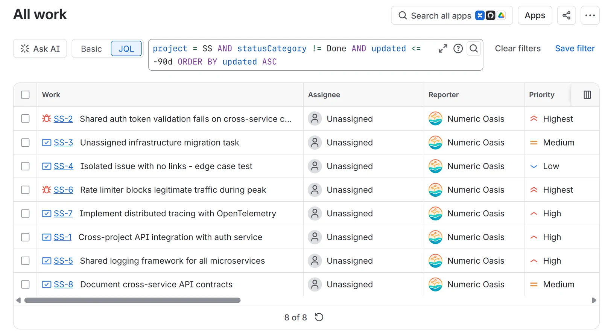

*Saved searches are the cheapest maintenance tool in Jira. These are the ones worth keeping.*

The JQL queries for Jira admins that pay off are not clever ones. They are a handful of plain searches that find work nobody is looking after: work items (formerly issues) that have not moved in months, work with no assignee, work stranded in sprints that already closed, work owned by people who have left, and spaces nobody opens any more.

Save each one as a filter, look at the results on a schedule, and hand each list to the person who can decide what happens to it. Boards stay honest, and reports stop counting work that quietly died a year ago.

Every query below uses fields and functions from Jira Cloud's current [JQL functions reference](https://support.atlassian.com/jira-software-cloud/docs/jql-functions/). Atlassian is renaming projects to spaces and issues to work items, but JQL keeps its old keywords: `project` and `issuetype` still work, and Atlassian's [JQL fields page](https://support.atlassian.com/jira-software-cloud/docs/jql-fields/) says to fall back to the old term if a new one does not parse yet.

## Which JQL queries do Jira admins need?

One query for each kind of neglect: stale work, unassigned work, work left in closed sprints, work owned by people who left, work with missing or missed due dates, and done work without a resolution. Run them monthly, sort oldest first, and send each list to the space's lead rather than fixing everything yourself.

Two habits make the queries work in every space. Use `statusCategory` instead of status names, because status names differ from space to space while every status belongs to To Do, In Progress or Done. And treat the thresholds (90 days, 30 days) as starting points: a support queue goes stale much faster than a roadmap.

## Stale work items

```
statusCategory != Done AND updated <= -90d ORDER BY updated ASC
```

Open work that nobody has touched in 90 days. Add `AND project = ABC` to slice it per space, and send each slice to that space's lead with three options: close it, move it back to the backlog, or bring it up to date.



## Unassigned and orphaned work

```
assignee is EMPTY AND statusCategory = "In Progress"
```

Work someone started and nobody owns. Usually the assignee left, or a bulk edit cleared the field. Assign it to whoever moved it last (the history shows who), or move it back to To Do.

```
assignee is EMPTY AND statusCategory != Done AND created <= -30d ORDER BY created ASC
```

The unowned backlog. A month without an owner usually means nobody wants it; ask the space lead to triage it or close it.

```
issuetype = Story AND parent is EMPTY AND statusCategory != Done
```

Stories with no parent. The `parent` field works in both team-managed and company-managed spaces. Attach each story to its epic, or confirm it really stands alone, so roll-up reports and plans can see it.

## Work left in closed sprints

```
sprint in closedSprints() AND sprint not in openSprints() AND sprint not in futureSprints() AND statusCategory != Done
```

A work item can belong to a completed sprint and an active one at the same time, so the two `not in` clauses matter: they keep only unfinished work whose last sprint closed and that nobody carried forward. Move it to the backlog or the next sprint, or close it. Left alone, it vanishes from the board while still counting as open.

## Work owned by people who left

```
assignee in inactiveUsers() AND statusCategory != Done
```

```
reporter in inactiveUsers() AND statusCategory != Done
```

`inactiveUsers()` matches deactivated accounts, and Atlassian's [knowledge base](https://support.atlassian.com/jira/kb/find-inactive-jira-cloud-users-without-using-third-party-apps/) documents it for the assignee, the reporter and other user fields. Reassign open work to the person's successor. For reported work, decide who owns the request now, because the reporter is often the one expected to confirm it is done. Both queries belong on the offboarding checklist, next to [removing the leaver's license](/blog/atlassian-license-reclamation/).

## Missing and missed due dates

```
duedate is EMPTY AND statusCategory != Done AND created <= -60d
```

```
duedate < startOfDay() AND statusCategory != Done ORDER BY duedate ASC
```

The first finds older work with no due date. It only matters in spaces where dates are expected, so name those spaces in the query. The second is the overdue list. Send it to the assignees, asking them to finish, re-date or close each item, rather than to the whole team.

## Done but not resolved

```
statusCategory = Done AND resolution is EMPTY
```

```
statusCategory != Done AND resolution is not EMPTY
```

Work in a done status without a resolution, and the reverse. Both distort reports and filters that look for resolved work. The cause is almost always a workflow transition that does not set or clear the resolution, so fix the workflow first, then bulk-correct the existing items. Team-managed service spaces have no resolution field, so rely on `statusCategory` there.

## How do you find Jira spaces nobody uses?

JQL cannot list dormant spaces, because it returns work items, not spaces. Instead, sort the list of spaces in Jira's admin settings by the date of the last work item update, as Atlassian's [knowledge base](https://support.atlassian.com/jira/kb/how-to-identify-inactive-projects-finding-projects-with-no-recent-issues-created-or-updated/) describes, then use JQL to see what is still open in each dormant one.

```
project = ABC AND statusCategory != Done ORDER BY updated ASC
```

Close or move what is left, then [archive the space](https://support.atlassian.com/jira-cloud-administration/docs/archive-a-project/). Space archiving is available on Premium and Enterprise; work items in an archived space drop out of search results but stay reachable by direct link.

## How do you turn these queries into a routine?

1. **Save each query as a filter** with a shared prefix, such as "Hygiene:", so they sort together.
2. **Share the filters with your admin group only.** Some of them list people by name.
3. **Subscribe to them.** A filter subscription emails the results on a schedule, so the review starts from an inbox rather than from memory.
4. **Slice by space and send each slice to the space lead.** They know which old work still matters.
5. **Apply agreed fixes with bulk change** from the search results, and add a comment saying why, so the next person who opens the work item understands what happened.

Scheduled automation rules can do some of this on their own, but their runs count against your plan's automation allowance. Start with filters, and automate only the fixes you have already made by hand a few times.

## The short version

Keep a small set of saved JQL searches for stale, unassigned, orphaned, sprint-stranded, leaver-owned, undated and unresolved work. Use `statusCategory` so they work in every space, review them monthly, and send the results to the people who can decide. The same habit pays off for configuration: custom fields pile up just like old work items, and a [custom field audit](/apps/field-scout/) gives you the equivalent list for fields.
