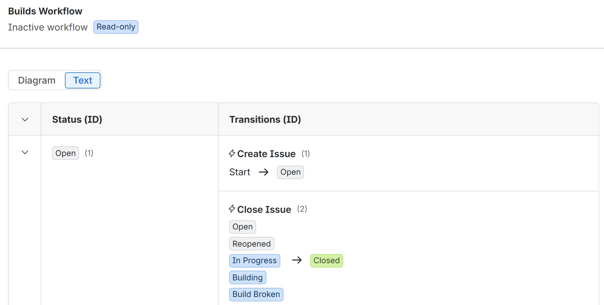

*Every extra status is one more board column, one more filter clause and one more way for a report to be wrong.*

To simplify Jira workflows, cut each workflow down to the statuses where work actually waits or changes hands, put every status in the right status category, and merge the rest with the workflow editor's built-in step for moving work items (formerly issues) to a new status. Do it per process, not per space, and update boards and filters in the same change.

The payoff is practical: narrower boards, JQL that survives the next reorganization, and reports that mean what they say. The risk is also practical, because the editor moves existing work items without running your workflow rules. The procedure at the end handles that.

## Why does status sprawl hurt boards and reports?

Each status has to be mapped to a board column, appears in filters by name, and feeds reports through its category. When a site carries Done, Closed, Resolved and Complete as separate statuses, every board, filter and dashboard has to list all four, and any one that misses a status quietly undercounts.

Atlassian's own documentation is blunt about two side effects: status categories control how work items appear in lists, reports and boards, and [reports are based on status names](https://support.atlassian.com/jira-cloud-administration/docs/what-is-a-workflow-status/), so renaming a status can change how they display. A status left unmapped on a board does not show on that board at all, so work can sit in it unseen.

Sprawl usually has an innocent origin: a team copies a workflow, adds "Waiting for vendor", another team adds "Blocked externally", and nobody owns the list.

## How do status categories work in Jira?

Every Jira status belongs to one of three categories: To Do, In Progress or Done, shown as grey, blue and green. You cannot add categories or change their colors. Lists, boards and reports read the category, so a status in the wrong category distorts every chart that uses it.

Two habits follow from that:

- **Audit the mapping.** A "Blocked" status filed under Done makes blocked work look finished. A "Ready for release" status filed under To Do makes finished work look untouched.
- **Filter by category where you can.** `statusCategory = "In Progress"` keeps working after you merge statuses; `status in ("In Dev", "Coding", "Doing")` breaks the day one of them disappears.

## Which statuses should you keep?

Keep a status when someone acts differently because of it: a different person or team picks the work up, a board column or queue depends on it, or an SLA, automation rule or approval keys off it. Merge statuses that differ only in wording. Replace temporary conditions, such as "waiting on someone", with a flag or a field rather than a status of their own.

A quick test for each status: if it vanished tomorrow, who would notice, and what would they do differently? If the answer is "nobody" or "nothing", it is a merge candidate.

## What happens to existing work items when you merge statuses?

In the workflow editor, deleting a status prompts you to choose a new status for the work items currently in it. The move runs after you select Update workflow, not when you delete. You can set exceptions so work items in certain spaces or work types go to a different status. Workflow rules do not run during the move.

Atlassian spells out the consequence in its guide to [moving work items while updating a workflow](https://support.atlassian.com/jira-software-cloud/docs/move-issues-to-new-statuses-while-updating-your-workflow/): Restrict transition and Validate details rules will not block anything, and Perform actions rules will not run. If a post function normally sets a resolution or clears a field on the way to Done, it will not happen for the moved items. Plan a bulk edit for those fields, or move items through a real transition before you delete the status.

Two more details from the same documentation set:

- **Removing is not deleting.** [Removing a status](https://support.atlassian.com/jira-cloud-administration/docs/remove-a-status-from-a-workflow/) from one workflow only stops that workflow using it. Deleting a status removes it from every workflow on the site.
- **The audit trail is thin.** The audit log records that the workflow was updated, but not which status was removed, and teams are not notified. Write down what you changed and tell the people affected.

## How do shared workflows change the plan?

In company-managed spaces, one workflow can serve many spaces through workflow schemes, and an edit applies to all of them at once. The workflow editor shows which spaces use a workflow before you publish, so check that list first. Team-managed spaces each own their workflows, so the same cleanup has to be repeated space by space.

Shared workflows are the goal, not the obstacle. Once statuses are consolidated, aim for one workflow per kind of process (software delivery, requests, approvals) shared by every space that runs that process. The trade-offs between the two space types are covered in [team-managed vs company-managed spaces](/blog/team-managed-vs-company-managed-spaces/).

## Which transitions and rules are worth keeping?

The [workflow editor](https://support.atlassian.com/jira-cloud-administration/docs/what-is-the-new-workflow-editor) groups transition rules as Restrict transition (conditions), Validate details (validators), Perform actions (post functions) and Request input (screens). Keep the rules that protect data quality or enforce a real control:

- A validator that requires the fields your reports depend on before work reaches Done.
- A restriction that limits approval transitions to the approvers.
- An action that sets the resolution when work is done, so resolution-based filters stay correct.

Question everything else, especially transitions that exist only to skip a step and screens that collect fields nobody reads.

## How to simplify Jira workflows, step by step

1. **Inventory.** List each workflow, its statuses and categories, and the spaces that use it. Count work items per status with JQL such as `status = "Closed" AND updated >= -180d`. The [JQL queries for administrators](/blog/jira-jql-queries-for-administrators/) post has more patterns.
2. **Design the target.** Write the short list of statuses per process, each with its category and the reason it exists.
3. **Find dependencies.** Board column mappings, saved filters and dashboards that name statuses, automation rules, JSM SLAs and queues, and integrations that read status names.
4. **Switch filters to categories** where that keeps their meaning, before anything else changes.
5. **Rehearse.** On Premium or Enterprise, try the change in a sandbox with a copy of production data first.
6. **Edit and move.** In the workflow editor, delete the redundant statuses, choose the target status for each, add exceptions if needed, then select Update workflow.
7. **Repair what rules would have done.** Bulk-set resolutions or fields that post functions normally handle.
8. **Remap boards and check reports.** Put the surviving statuses in the right columns and spot-check the reports teams use.
9. **Delete orphans.** Once no workflow uses an old status, delete it so nobody reuses it.
10. **Communicate and record.** Tell each team what changed, and keep the before and after list.

## The short version

Simplifying Jira workflows means fewer statuses, each in the right category, shared across every space that runs the same process. Merge with the workflow editor's move step, but remember that it skips workflow rules, so repair resolutions and fields yourself, then remap boards and switch filters to `statusCategory`. Because the native audit log does not say which status was removed, a configuration history is worth having before you start: [Configuration Monitor](/apps/configuration-monitor/) records Jira space configuration changes, workflows included, with before and after values.
