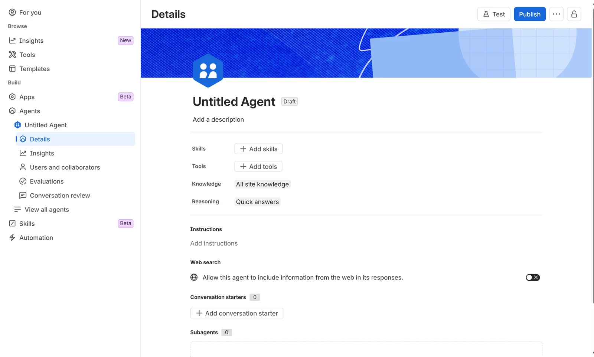

*La mayoría de los primeros agentes son asistentes genéricos que nadie ha pedido. Los que se usan hacen una sola cosa y la hacen bien.*

Para crear un agente de Rovo, abre Rovo Studio, selecciona **Agents** y después **Create an agent**. Describe lo que quieres en lenguaje natural y el asistente de creación prepara un borrador con nombre, instrucciones y sugerencias de conversación, o selecciona **Start from blank** y rellena cada parte tú mismo. También puedes empezar desde Rovo Chat, con **Create agent**, o desde el selector de responsable de un elemento de trabajo de Jira.

Los clics llevan minutos. Que alguien use el agente un mes después se decide antes, por lo concreta que sea su tarea, y después, por cómo lo pruebes con preguntas reales.

## Elige una tarea concreta

Un buen primer agente responde a un tipo de pregunta, o hace un tipo de tarea, para un público. Tres pruebas ayudan:

- **Ocurre cada semana.** Alguien lo pregunta, o lo hace a mano, con la frecuencia suficiente para que ahorrar ese tiempo importe.
- **La respuesta está en contenido que controlas.** Un espacio de Confluence, un conjunto de elementos de trabajo de Jira, una carpeta de políticas.
- **Puedes distinguir una respuesta correcta de una incorrecta.** Si dos expertos no se pondrían de acuerdo, el agente no lo hará mejor.

Ejemplos que pasan la prueba: "Responder dudas sobre la política de viajes y gastos a partir del espacio de Finanzas." "Redactar notas de versión a partir de los elementos de trabajo de una fix version." "Sugerir el tipo de solicitud y la prioridad de las nuevas solicitudes de servicio." Un ejemplo que no la pasa: "Un asistente útil para el equipo."

Escribe la tarea en una frase. Después reúne diez preguntas reales que la gente hizo el mes pasado, por chat, correo o en el centro de servicio, con la respuesta que esperarías. Esa lista es tu conjunto de pruebas.

## ¿Cómo se crea un agente de Rovo en Studio?

Abre Rovo Studio desde el selector de apps, selecciona **Agents**, después **View all agents** y **Create an agent**. Una ventana pregunta qué debe hacer el agente: lo describes y dejas que el asistente prepare el borrador, o seleccionas **Start from blank** para configurarlo tú. Empezar desde cero guarda un borrador al momento, que solo se publica cuando seleccionas **Publish**. La [guía de Atlassian para crear agentes](https://support.atlassian.com/rovo/docs/create-and-edit-agents/) todavía usa los nombres antiguos de los botones (**Create** en Rovo agent, **Skip to manual setup** y **Activate**), así que puedes encontrarte cualquiera de los dos.

La configuración manual da más control y deja cada decisión a la vista. La página de detalles del agente incluye:

- **Name** (nombre). Que diga lo que hace: "Asistente de la política de gastos", no "Penny".
- **Description** (descripción). Se muestra cuando la gente busca agentes, así que escríbela para ellos: qué preguntar y qué no.
- **Instructions** (instrucciones). Lo que se aplica en cualquier situación, como el papel y el tono del agente.
- **Conversation starters** (sugerencias de conversación). Primeras preguntas sugeridas. Usa tres de tus diez preguntas de prueba; si lo dejas en blanco, Rovo muestra unas genéricas.

La misma página define las **Skills** (habilidades), las **Tools** (herramientas), el **Knowledge** (conocimiento: todo el sitio, hasta que lo acotes) y el **Reasoning** (razonamiento: respuestas rápidas por defecto) del agente, y si puede usar **Web search** (búsqueda web). Los **Subagents** (subagentes) son opcionales, para un agente que necesita instrucciones distintas según el tipo de petición. En un primer agente, déjalos fuera.



## Escribe las instrucciones como un briefing para un compañero nuevo

Los agentes siguen las instrucciones al pie de la letra, así que unas instrucciones vagas producen respuestas vagas. Una estructura que funciona:

```
Papel: Respondes dudas de los empleados sobre la política de viajes y gastos.
Fuentes: Usa solo las páginas del espacio de Finanzas en "Viajes y gastos".
Pasos: Localiza el apartado de la política que aplica, responde en dos a cuatro frases
y enlaza la página que has usado.
Formato: Frases sencillas. Importes y límites exactamente como figuran en la política.
Si dudas: Di que no lo has encontrado y sugiere abrir una solicitud
en el espacio de servicio de Finanzas. No inventes nunca un límite ni una regla de aprobación.
```

Escribe en imperativo, nombra las fuentes y di qué hacer cuando la respuesta no está. Esa última línea evita la mayoría de las malas respuestas.

## Elige pocas fuentes de conocimiento, no todas

El conocimiento es el contenido en el que busca el agente: espacios concretos de Confluence, espacios de Jira, una carpeta de Google Drive y fuentes similares. Un conjunto acotado da respuestas acotadas; apuntar un agente concreto a todo es invitarlo a citar la página equivocada.

Dos comprobaciones antes de conectar una fuente:

1. **¿Está al día?** El agente cita una página obsoleta con la misma facilidad que la vigente. Archiva primero lo antiguo.
2. **¿Puede leerla el público?** Atlassian [deja claro](https://support.atlassian.com/rovo/docs/rovo-agent-permissions-and-governance/) que los agentes solo acceden a la información que la persona que los usa tiene permiso para ver o editar. Si la política de gastos está en un espacio que media empresa no puede abrir, media empresa recibirá respuestas pobres.

## Añade solo las herramientas que la tarea necesita

Las herramientas, que algunas guías todavía llaman acciones, permiten al agente hacer cosas: buscar elementos de trabajo, crear uno, comentar, actualizar una página. Atlassian recomienda [no pasar de cinco herramientas](https://support.atlassian.com/rovo/docs/create-and-edit-agents/) por agente, por rendimiento.

Empieza solo con lectura. Añade herramientas que escriben únicamente cuando las respuestas hayan demostrado ser fiables, y recuerda que el agente actúa en nombre de quien lo usa, con sus permisos. La profundidad de razonamiento es un ajuste aparte que equilibra velocidad, coste y calidad; un razonamiento más profundo consume más [créditos de Rovo](https://support.atlassian.com/rovo/docs/rovo-usage-limits/), así que súbelo solo si las respuestas lo necesitan.

## ¿Cómo se prueba un agente de Rovo antes de compartirlo?

Pasa tus diez preguntas reales por el agente, primero en el panel de pruebas de Studio mientras lo editas y después en Rovo Chat, donde la gente lo va a usar de verdad. Prueba con la sesión de alguien que tenga los permisos del público, no como administrador. Marca cada respuesta como correcta, incompleta, errónea o rechazada, corrige las instrucciones o las fuentes y vuelve a pasar el conjunto.

Repite hasta que desaparezcan las respuestas erróneas y los rechazos sean los que tocan. Después añade unas cuantas preguntas incómodas: una que el agente deba rechazar, una con una errata, una que mezcle dos temas. Guarda el conjunto de pruebas y vuelve a pasarlo cada vez que cambies las instrucciones o el conocimiento.

## Compártelo con quien lo necesita

Por defecto, los agentes son visibles para todo el mundo en la organización. Puedes restringir un agente a personas concretas; en ese caso, los demás no lo ven al explorar los agentes ni en las automatizaciones. Para indicárselo a alguien, comparte el enlace a su perfil desde Rovo Chat.

En **Users and permissions**, organiza la propiedad para que el agente sobreviva a una reorganización:

- El **propietario** es quien lo creó.
- Los **editores** pueden modificarlo; los **gestores** además pueden añadir editores y eliminarlo.
- El nombre de autor que se muestra puede ser un equipo en lugar de una persona.

Añade al menos un gestor además de ti. Los administradores de Studio deciden también quién puede crear agentes; si todavía no lo has definido, consulta [cómo activar Rovo](/es/blog/before-you-turn-on-rovo/).

## ¿Cómo se mide si la gente usa un agente de Rovo?

Abre el agente en Studio y selecciona **Insights**. Ahí ves la media de usuarios diarios y el total de conversaciones en un periodo, por defecto los últimos 31 días, y puedes añadir ambos como gráficos a un dashboard de Atlassian Home. Atlassian presenta los [datos de uso de agentes](https://support.atlassian.com/rovo/docs/track-how-often-a-rovo-agent-is-used/) como beta abierta en el momento de esta publicación.

Las cifras te dicen si la gente vuelve; no te dicen si las respuestas eran correctas. Combínalas con una comprobación mensual: vuelve a pasar el conjunto de pruebas, lee una muestra de conversaciones reales si tu proceso lo permite y pregunta a tres usuarios habituales qué cambiarían. Decide de antemano qué es el éxito, por ejemplo una parte del público objetivo usándolo cada semana, y retira los agentes que no lleguen.

## En resumen

Da a tu primer agente de Rovo una tarea concreta y frecuente, con respuestas que puedas verificar. Escribe las instrucciones como un briefing, apúntalo a pocas fuentes al día que el público pueda leer, añade solo las herramientas necesarias y empieza solo con lectura. Pruébalo con diez preguntas reales como un usuario normal, compártelo con un segundo gestor ya asignado y sigue los datos de uso junto con una comprobación de calidad periódica. Si la tarea necesita una acción personalizada o una integración que Rovo aún no ofrece, el [equipo de Atlassian de Numeric Oasis](/es/atlassian/) desarrolla apps de Forge a medida.
