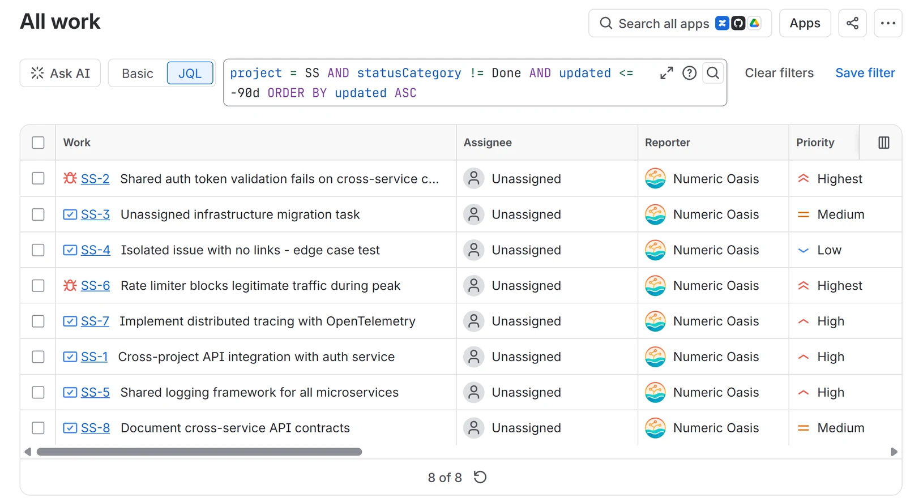

*Las búsquedas guardadas son la herramienta de mantenimiento más barata de Jira. Estas son las que merece la pena conservar.*

Las consultas JQL para administradores de Jira que de verdad compensan no son las más ingeniosas. Son unas cuantas búsquedas sencillas que encuentran trabajo que nadie está atendiendo: elementos de trabajo que no se mueven desde hace meses, trabajo sin responsable, trabajo olvidado en sprints que ya terminaron, trabajo de personas que se han ido y espacios que ya nadie abre.

Guarda cada una como filtro, revisa los resultados con una frecuencia fija y entrega cada lista a quien puede decidir qué hacer con ella. Los tableros reflejan la realidad y los informes dejan de contar trabajo que murió en silencio hace un año.

Todas las consultas usan campos y funciones de la [referencia actual de funciones JQL](https://support.atlassian.com/jira-software-cloud/docs/jql-functions/) de Jira Cloud. Atlassian está cambiando "proyectos" por "espacios" y ahora llama "elementos de trabajo" a lo que antes eran incidencias, pero JQL conserva sus palabras clave antiguas: `project` e `issuetype` siguen funcionando, y la [página de campos JQL](https://support.atlassian.com/jira-software-cloud/docs/jql-fields/) de Atlassian recomienda volver al término antiguo si uno nuevo todavía no se reconoce.

## ¿Qué consultas JQL necesita un administrador de Jira?

Una consulta por cada tipo de abandono: trabajo parado, trabajo sin responsable, trabajo olvidado en sprints cerrados, trabajo de quien se fue, trabajo sin fecha de vencimiento o con la fecha superada, y trabajo terminado sin resolución. Lánzalas una vez al mes, ordénalas de más antigua a más reciente y envía cada lista al responsable del espacio en lugar de arreglarlo todo tú.

Dos hábitos hacen que las consultas funcionen en cualquier espacio. Usa `statusCategory` en lugar de nombres de estado, porque los nombres cambian de un espacio a otro, mientras que todo estado pertenece a una de tres categorías: To Do, In Progress o Done. Y toma los plazos (90 días, 30 días) como punto de partida: una cola de soporte envejece mucho más rápido que un roadmap.

## Elementos de trabajo parados

```
statusCategory != Done AND updated <= -90d ORDER BY updated ASC
```

Trabajo abierto que nadie ha tocado en 90 días. Añade `AND project = ABC` para dividirlo por espacio y envía cada parte al responsable del espacio con tres opciones: cerrarlo, devolverlo al backlog o actualizarlo.



## Trabajo sin responsable y trabajo huérfano

```
assignee is EMPTY AND statusCategory = "In Progress"
```

Trabajo que alguien empezó y que nadie asume. Normalmente el responsable se fue o una edición masiva vació el campo. Asígnalo a quien lo movió por última vez (el historial lo muestra) o devuélvelo a To Do.

```
assignee is EMPTY AND statusCategory != Done AND created <= -30d ORDER BY created ASC
```

El backlog sin dueño. Un mes sin responsable suele significar que nadie quiere ese trabajo; pide al responsable del espacio que lo clasifique o lo cierre.

```
issuetype = Story AND parent is EMPTY AND statusCategory != Done
```

Historias sin elemento padre. El campo `parent` funciona tanto en espacios gestionados por el equipo como en espacios gestionados por la empresa. Vincula cada historia a su epic, o confirma que de verdad va por libre, para que los informes agregados y los planes puedan verla.

## Trabajo olvidado en sprints cerrados

```
sprint in closedSprints() AND sprint not in openSprints() AND sprint not in futureSprints() AND statusCategory != Done
```

Un elemento de trabajo puede pertenecer a un sprint completado y a uno activo a la vez, así que las dos cláusulas `not in` importan: dejan solo el trabajo sin terminar cuyo último sprint se cerró y que nadie arrastró al siguiente. Muévelo al backlog o al próximo sprint, o ciérralo. Si se queda así, desaparece del tablero y sigue contando como abierto.

## Trabajo de personas que se fueron

```
assignee in inactiveUsers() AND statusCategory != Done
```

```
reporter in inactiveUsers() AND statusCategory != Done
```

La función `inactiveUsers()` encuentra cuentas desactivadas, y la [base de conocimiento](https://support.atlassian.com/jira/kb/find-inactive-jira-cloud-users-without-using-third-party-apps/) de Atlassian documenta su uso con el responsable, el informador y otros campos de usuario. Reasigna el trabajo abierto a quien haya asumido las funciones de esa persona. En el trabajo que informó, decide quién es ahora el dueño de la petición, porque a menudo es el informador quien confirma que algo está resuelto. Las dos consultas deben estar en la lista de bajas, junto a [retirar la licencia de quien se va](/es/blog/atlassian-license-reclamation/).

## Fechas de vencimiento ausentes y superadas

```
duedate is EMPTY AND statusCategory != Done AND created <= -60d
```

```
duedate < startOfDay() AND statusCategory != Done ORDER BY duedate ASC
```

La primera encuentra trabajo antiguo sin fecha de vencimiento. Solo importa en los espacios donde se esperan fechas, así que nombra esos espacios en la consulta. La segunda es la lista de retrasos. Envíala a los responsables pidiéndoles que terminen, cambien la fecha o cierren cada elemento, no a todo el equipo.

## Terminado, pero sin resolución

```
statusCategory = Done AND resolution is EMPTY
```

```
statusCategory != Done AND resolution is not EMPTY
```

Trabajo en un estado terminado sin resolución, y al revés. Los dos distorsionan los informes y los filtros que buscan trabajo resuelto. La causa casi siempre es una transición del flujo de trabajo que no rellena o no borra la resolución, así que corrige primero el flujo y luego ajusta en bloque los elementos existentes. Los espacios de servicio gestionados por el equipo no tienen campo de resolución; en ellos, usa `statusCategory`.

## ¿Cómo encontrar espacios de Jira que nadie usa?

JQL no puede listar espacios parados, porque devuelve elementos de trabajo, no espacios. Ordena en su lugar la lista de espacios de la administración de Jira por la fecha de la última actualización de un elemento, como describe la [base de conocimiento](https://support.atlassian.com/jira/kb/how-to-identify-inactive-projects-finding-projects-with-no-recent-issues-created-or-updated/) de Atlassian, y después usa JQL para ver qué sigue abierto en cada espacio parado.

```
project = ABC AND statusCategory != Done ORDER BY updated ASC
```

Cierra o mueve lo que quede y después [archiva el espacio](https://support.atlassian.com/jira-cloud-administration/docs/archive-a-project/). El archivado de espacios está disponible en Premium y Enterprise; los elementos de un espacio archivado salen de los resultados de búsqueda, pero siguen accesibles por enlace directo.

## ¿Cómo convertir estas consultas en una rutina?

1. **Guarda cada consulta como filtro** con un prefijo común, como "Higiene:", para que aparezcan juntas.
2. **Comparte los filtros solo con el grupo de administradores.** Algunos muestran personas por su nombre.
3. **Suscríbete a ellos.** La suscripción a un filtro envía los resultados por correo con la frecuencia que elijas, y la revisión empieza en la bandeja de entrada, no en la memoria.
4. **Divide por espacio y envía cada parte al responsable del espacio.** Es quien sabe qué trabajo antiguo sigue importando.
5. **Aplica los cambios acordados con la edición masiva** desde los resultados de búsqueda y deja un comentario con el motivo, para que la próxima persona que abra el elemento entienda qué pasó.

Las reglas de automatización programadas pueden hacer parte de esto solas, pero cada ejecución cuenta contra la cuota de automatización de tu plan. Empieza por los filtros y automatiza solo las correcciones que ya hayas hecho a mano varias veces.

## En resumen

Mantén un pequeño conjunto de búsquedas JQL guardadas para el trabajo parado, sin responsable, huérfano, olvidado en sprints, de personas que se fueron, sin fecha y sin resolución. Usa `statusCategory` para que funcionen en todos los espacios, revísalas cada mes y envía los resultados a quien puede decidir. El mismo hábito sirve para la configuración: los custom fields se acumulan igual que los elementos antiguos, y una [auditoría de custom fields](/es/apps/field-scout/) te da la lista equivalente para los campos.
