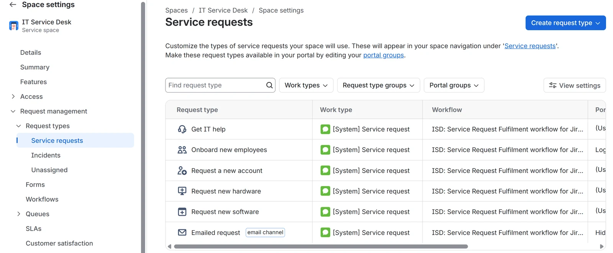

*El cliente no conoce tus tipos de trabajo ni la estructura de tu equipo. Sabe qué se ha roto y qué necesita.*

Los tipos de solicitud y los formularios de JSM deciden si el cliente encuentra la puerta correcta a la primera. Los tipos de solicitud son las opciones que el cliente elige en el portal, los formularios recogen los detalles y el portal, dentro de un centro de ayuda, es donde viven ambos. Diseña los tres desde el lado del cliente.

En la práctica: nombra los tipos de solicitud con las palabras que usa el cliente, agrúpalos para que ninguna lista se alargue, pregunta solo lo que el agente necesita para empezar, oculta los campos internos que el cliente no debería ver nunca y observa a unas cuantas personas reales usando el portal antes de darlo por terminado.

## ¿Qué es un tipo de solicitud en Jira Service Management?

Un tipo de solicitud es la puerta de entrada del cliente a un espacio de servicio: un nombre, una descripción, un icono y un formulario de solicitud. Cada tipo de solicitud crea un elemento de trabajo del tipo de trabajo que elijas, y varios tipos de solicitud pueden usar el mismo tipo de trabajo. El cliente ve tipos de solicitud; el agente ve elementos de trabajo.

Se gestionan en la configuración del espacio, en **Request management** (gestión de solicitudes) y después **Request types** (tipos de solicitud). Cada uno tiene un grupo del portal, un formulario de solicitud (lo que rellena el cliente), una vista del elemento de trabajo (lo que ve el agente) y nombres orientados al cliente para los estados del workflow. Esto último importa más de lo que parece: un cliente que ve "Pendiente de aprobación" entiende mejor su solicitud que uno que ve "Triaje N2".

## Nombra los tipos de solicitud como el cliente describe el problema

El error de portal más habitual es nombrar los tipos de solicitud según el equipo o el sistema que los atiende: "Gestión de accesos", "Soporte ERP", "Hardware N1". Un cliente cuyo portátil no carga no sabe cuál de ellos es el suyo.

Nombra cada tipo de solicitud según el problema o el objetivo, empezando por un verbo cuando puedas:

- "No puedo iniciar sesión" o "Restablecer mi contraseña", no "Identidad y acceso".
- "Se me ha roto el portátil o el móvil", no "Incidencia de hardware".
- "Pedir acceso a una aplicación", no "Solicitud de aprovisionamiento".

Usa la línea de descripción para poner ejemplos: "Monitor, teclado, base de conexión, móvil". El cliente recorre las descripciones buscando el sustantivo que tiene en la cabeza.

Para dar con las palabras, lee los resúmenes de las últimas cien solicitudes que llegaron por correo o chat. Los clientes ya te han contado cómo describen sus problemas. Después, mantén la lista corta: cada tipo de solicitud debe existir porque se enruta de otra forma, hace otras preguntas o necesita otro objetivo de SLA (consulta [cómo configurar SLA en Jira Service Management](/es/blog/jsm-sla-design/)). Si dos tipos de solicitud hacen lo mismo, fusiónalos. Si uno lleva seis meses sin usarse, retíralo.

## ¿Cuántos tipos de solicitud debe tener un grupo del portal?

Mantén cada grupo lo bastante corto como para leerlo de un vistazo. La [documentación de Data Center de Atlassian](https://confluence.atlassian.com/servicemanagementserver110/setting-up-request-types-1627463510.html) recomienda agrupar los tipos de solicitud cuando el portal tiene siete o más, y [los grupos solo aparecen en el portal](https://support.atlassian.com/jira-service-management-cloud/docs/organize-request-types-into-portal-groups/) si hay más de uno. Un tipo de solicitud puede estar en varios grupos, así que puede aparecer allí donde el cliente lo buscaría.

Agrupa según el objetivo del cliente, no según tus equipos: "Algo no funciona", "Pedir acceso", "Comprar o solicitar algo", "Hacer una consulta". Pon los tipos más usados arriba en cada grupo.

## ¿Cómo funcionan los formularios de Jira Service Management?

Los formularios son un generador de formularios dentro del espacio de servicio. Cuando adjuntas un formulario a un tipo de solicitud, el cliente lo ve como parte del formulario de solicitud de ese tipo, junto con los campos de Jira ya configurados. Los formularios aportan lo que el formulario de solicitud básico no tiene, como secciones que solo aparecen según las respuestas anteriores.

Hay [dos formas de adjuntar uno](https://support.atlassian.com/jira-service-management-cloud/docs/add-a-form-to-the-portal-form-for-a-request-type/): abrir el tipo de solicitud y elegir **Attach form** (crear desde una plantilla o seleccionar un formulario existente), o abrir el formulario desde **Forms**, ir a **Settings** y activar **Attach to request types**.

Unas cuantas reglas mantienen útiles los formularios:

1. **Pregunta solo lo que el agente necesita para empezar.** Cada pregunta de más le cuesta tiempo al cliente y aumenta la probabilidad de que elija un tipo de solicitud más genérico para esquivarla.
2. **Usa secciones condicionales en lugar de más tipos de solicitud.** "¿Qué aplicación?" seguido de preguntas específicas de esa aplicación es mejor que diez tipos casi idénticos.
3. **Vincula un campo del formulario a un campo de Jira cuando necesites el valor en otro sitio**, por ejemplo en colas, JQL, objetivos de SLA o automatizaciones. Los campos de formulario sin vincular aparecen debajo de los campos de Jira, en el portal y en la vista del elemento de trabajo.
4. **No preguntes lo mismo dos veces.** Si una pregunta está en el formulario, quita el campo equivalente del formulario de solicitud.

## Oculta lo que el cliente no debería tener que responder

Algunos valores los necesita el equipo, pero el cliente nunca debería elegirlos: el equipo o el componente responsable, una categoría para los informes, una etiqueta para la automatización. En la pestaña **Request form** del tipo de solicitud, añade el campo y marca **Use preset value and hide from portal** (usar un valor predefinido y ocultarlo en el portal). A partir de ahí, cada solicitud de ese tipo llega con el valor ya puesto.

Algunos campos solo se pueden usar así: Responsable, Elementos de trabajo vinculados y varios campos de selección admiten un valor predefinido, pero no pueden mostrarse en el portal. Otros, como Tipo de trabajo, Informador, Nivel de seguridad y Participantes de la solicitud, no se pueden añadir a un tipo de solicitud. Atlassian enumera ambos grupos en su página sobre [campos ocultos y no compatibles](https://support.atlassian.com/jira-service-management-cloud/docs/what-are-hidden-fields-and-unsupported-fields-in-request-types/).

Ya que estás en el tipo de solicitud, abre los estados del workflow y da a cada estado interno un nombre que el cliente entienda. Varios estados internos pueden compartir un mismo nombre de cara al cliente.

## Organiza el portal desde el centro de ayuda

El cliente llega primero al centro de ayuda, luego elige un portal y después un tipo de solicitud. Tres decisiones de diseño pesan más que el resto:

- **La página de inicio del centro de ayuda.** En el editor actual del centro de ayuda puedes organizar la página de inicio y elegir qué portales destacar u ocultar. En los planes Premium y Enterprise también puedes [crear varios centros de ayuda](https://support.atlassian.com/jira-service-management-cloud/docs/create-and-manage-help-centers/) para públicos distintos.
- **El nombre, el texto de introducción y el logotipo de cada portal**, que se definen en la configuración del espacio. Limita la introducción a una o dos frases sobre para qué sirve el portal.
- **El orden de los grupos y de los tipos de solicitud.** Las solicitudes más habituales deben verse sin desplazarse por la página.

## ¿Cómo se prueba un portal de servicio con usuarios reales?

Da a entre tres y cinco personas que nunca hayan visto el portal unas cuantas tareas realistas, como "Tu portátil no carga. Pide ayuda", y obsérvalas sin ayudar. Anota qué tipo de solicitud abren primero, dónde dudan y qué escriben. Cada primera elección equivocada es un problema de nombre o de agrupación, no del usuario.

Un procedimiento breve:

1. Elige de cinco a ocho tareas a partir de solicitudes reales del último mes.
2. Busca personas ajenas al equipo que gestiona el portal.
3. Comparte pantalla, lee cada tarea en voz alta y no digas nada mientras trabajan.
4. Renombra, reagrupa o fusiona después de cada ronda y vuelve a probar.

Después del lanzamiento, vigila con qué frecuencia los agentes tienen que cambiar el tipo de solicitud de los elementos de trabajo que entran. Un tipo de solicitud que se corrige a menudo es uno que el cliente no entiende.

## En resumen

Nombra los tipos de solicitud según el problema del cliente, agrúpalos por su objetivo y mantén cada grupo corto. Usa formularios para las preguntas condicionales, vincula solo los campos que necesites en otro sitio y rellena los valores internos con campos ocultos predefinidos en lugar de preguntárselos al cliente. Organiza el centro de ayuda para que las solicitudes habituales aparezcan primero y observa a unas cuantas personas reales usando el portal antes del lanzamiento y después de cada cambio importante. Si quieres ayuda para rediseñar un portal existente, el [equipo de Atlassian de Numeric Oasis](/es/atlassian/) se dedica a este tipo de trabajo de gestión de servicios.
