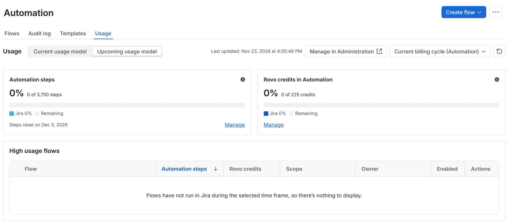

*A automação é medida. As regras que mais consomem a cota costumam ser as silenciosas, que ninguém lembra de ter criado.*

Os limites de automação do Jira são cotas mensais atreladas ao seu plano, e a forma como a Atlassian as conta está mudando. Hoje o Jira conta execuções de regra bem-sucedidas, por produto: uma execução que realiza pelo menos uma ação conta uma vez, não importa quantas ações tenha. A partir de 3 de dezembro de 2026, a automação passa a ser medida em etapas (cada gatilho, condição, ação e ramificação que roda), somadas em toda a organização, com cotas por usuário nos planos pagos.

Os dois modelos premiam os mesmos hábitos: regras que disparam só quando precisam, param cedo quando não há nada a fazer e terminam o trabalho de uma vez. A seguir, como cada modelo conta, onde acompanhar o uso e o que mudar primeiro.

## Como os limites de automação do Jira são contados hoje?

Uma execução de regra conta para o limite mensal quando realiza pelo menos uma ação com sucesso, e conta uma vez só, não importa quantas ações execute. Execuções que uma condição interrompe antes de qualquer ação, regras de sistema criadas pela Atlassian e tarefas de apoio, como registrar log ou criar variável, não contam. Cada produto Jira tem seu limite, e o Enterprise é ilimitado.

Esse é o modelo que a Atlassian adotou em novembro de 2023, resumido no seu [artigo sobre limites e uso da automação](https://support.atlassian.com/automation/kb/difference-between-automation-service-limits-and-automation-usage-limits/). O escopo não muda a conta: regras de um espaço, de vários espaços ou globais consomem o mesmo limite mensal, e cada plano acima do Free tem um limite maior.

O mesmo artigo faz uma distinção que vale conhecer. O limite mensal de uso é uma coisa; os [limites de serviço](https://support.atlassian.com/cloud-automation/docs/automation-service-limits/) são outra. Os limites de serviço restringem o que uma única execução pode fazer (quantos itens de trabalho uma busca devolve, quanto tempo de processamento as regras usam, quantas vezes as regras podem disparar umas às outras antes de a detecção de loop interrompê-las), e mudar de plano não os aumenta.

## O que muda em 3 de dezembro de 2026?

A Atlassian [anunciou em 1º de setembro de 2026](https://www.atlassian.com/blog/company-news/expanded-usage-based-pricing) que a automação passa para cobrança por uso, medida em etapas. Cada gatilho, condição, ação e ramificação que roda é uma etapa, loops contam para cada item, e as cotas são somadas em toda a organização. Planos pagos podem passar da cota e pagar o excedente; o plano Free para.

As cotas mensais que a Atlassian publica para o Jira no seu [artigo sobre o cálculo do uso](https://support.atlassian.com/cloud-automation/docs/how-is-my-usage-calculated/) são:

| Plano do Jira | Etapas de automação por mês |
| --- | --- |
| Free | 150 por assinatura |
| Standard | 400 por usuário |
| Premium | 750 por usuário |
| Enterprise | 1.000 por usuário |

Os outros produtos têm cotas próprias, que se somam ao mesmo total da organização. Ações do Rovo dentro de uma regra consomem créditos do Rovo, e não etapas. O preço das etapas excedentes está nas páginas de preços da Atlassian; confira lá, em vez de confiar em um valor citado num blog.

Duas consequências importam mais do que a tabela. Primeiro, o Enterprise deixa de ser ilimitado. Segundo, o tamanho de cada execução passa a pesar. No modelo de execuções, uma regra que editava 200 itens de trabalho numa ramificação contava uma vez, igual a uma regra que editava um. No modelo de etapas, cada ação dentro da ramificação conta para cada item, e regras que eram baratas como execução única podem virar a maior linha do medidor.

## Onde ver o uso da automação?

No Jira, a automação global tem uma aba Usage (abra Settings, depois System, depois a automação global) que mostra o uso no mês até agora, o limite do plano e a projeção para o fim do mês. É preciso ter a permissão global Administer Jira. Os insights de desempenho das regras de automação mostram quais regras rodam com mais frequência, e é por elas que a limpeza deve começar. Na versão mais nova da tela, as regras se chamam flows, e um seletor no topo mostra o modelo de uso atual ou o próximo: passos de automação e créditos do Rovo contra a cota, a data em que zeram e os flows que mais consomem.

Para os novos medidores, a Atlassian informou que os administradores da organização ganham visões de uso e controles de gasto no Atlassian Administration. O [artigo sobre uso adicional](https://support.atlassian.com/subscriptions-and-billing/docs/manage-extra-usage-for-a-meter/) explica como definir um limite mensal ou desligar o uso adicional, e avisa que os administradores são notificados ao atingir 80% e 100% da cota. Com o uso adicional desligado, os recursos medidos podem parar até o próximo ciclo de cobrança, então decida qual comportamento você quer antes de dezembro.

## Quais regras consomem a cota?

Procure estes padrões, mais ou menos em ordem de custo:

- **Gatilhos amplos.** O gatilho de atualização de item de trabalho dispara a cada edição de qualquer campo. O gatilho "Field value changed", configurado para o único campo que interessa à regra, dispara muito menos.
- **Escopo global para um trabalho de um espaço só.** Uma regra global recebe eventos de todos os espaços. Restrinja o escopo aos espaços que precisam dela.
- **Condições tardias ou caras.** Uma regra que faz três consultas antes de verificar se o item é do tipo certo paga pelas consultas toda vez. Coloque as comparações simples primeiro; uma condição JQL custa mais do que uma comparação de campo.
- **Regras agendadas muito frequentes.** Uma regra que roda a cada hora sobre uma busca JQL que devolve sempre os mesmos itens refaz o mesmo trabalho sem parar.
- **Uma mensagem por item de trabalho.** Dez notificações para dez itens atrasados são dez conjuntos de ações; um resumo é um.
- **Regras que disparam regras.** Uma regra autorizada a disparar a partir das ações de outra pode multiplicar as execuções e, no pior caso, termina na detecção de loop.
- **Regras órfãs.** Regras cujo dono saiu, ou que atuam em espaços que ninguém usa, continuam rodando.

## Como cortar o desperdício da automação?

1. **Comece pelos dados.** Abra a aba Usage e os insights de desempenho, liste as dez regras que mais rodam e trabalhe nessa lista. A maior parte do desperdício costuma estar em poucas regras.
2. **Estreite o gatilho.** Troque o gatilho de atualização de item pelo "Field value changed" sempre que a regra só se importar com um campo.
3. **Estreite o escopo.** Leve as regras globais para os espaços que precisam delas.
4. **Reordene as condições.** As mais baratas e mais seletivas primeiro, para que a maioria das execuções pare na primeira verificação.
5. **Faça o JQL agendado devolver só o que precisa mudar.** Exclua o que a regra já tratou, por exemplo com `AND labels != escalated`, e reduza a frequência quando uma hora de atraso não fizer diferença. As [consultas JQL para administradores](/pt-BR/blog/jira-jql-queries-for-administrators/) mostram o estilo: buscas que devolvem só o que precisa de atenção.
6. **Agrupe as notificações.** Consulte os itens de uma vez e mande uma única mensagem com a lista, em vez de uma mensagem por item.
7. **Use a alteração em massa para correções pontuais.** Uma edição em massa que você vai fazer uma vez só pertence à alteração em massa do Jira, a partir dos resultados da busca, e não a uma regra temporária. A alteração em massa é um recurso nativo do Jira e deixa a cota de automação para as regras que rodam todo dia.
8. **Dê um dono a cada regra.** Escreva o dono e o objetivo na descrição da regra e desative as regras que ninguém reivindicar.
9. **Defina o limite de uso adicional antes de 3 de dezembro**, para que a primeira conta no modelo de etapas seja um valor que você escolheu.

## Em resumo

A automação do Jira tem limite por plano: hoje em execuções de regra bem-sucedidas por produto e, a partir de 3 de dezembro de 2026, em etapas somadas em toda a organização, onde ramificações e loops grandes custam mais do que antes. Consulte a aba Usage e os insights de desempenho, estreite gatilhos e escopos, coloque as condições baratas primeiro, faça as buscas agendadas devolverem só o que precisa mudar, agrupe notificações e defina o limite de uso adicional antes da mudança. Se quiser uma segunda opinião sobre um conjunto grande de regras antes disso, a revisão de regras faz parte do trabalho de administração do Jira que a [equipe Atlassian da Numeric Oasis](/pt-BR/atlassian/) realiza.
