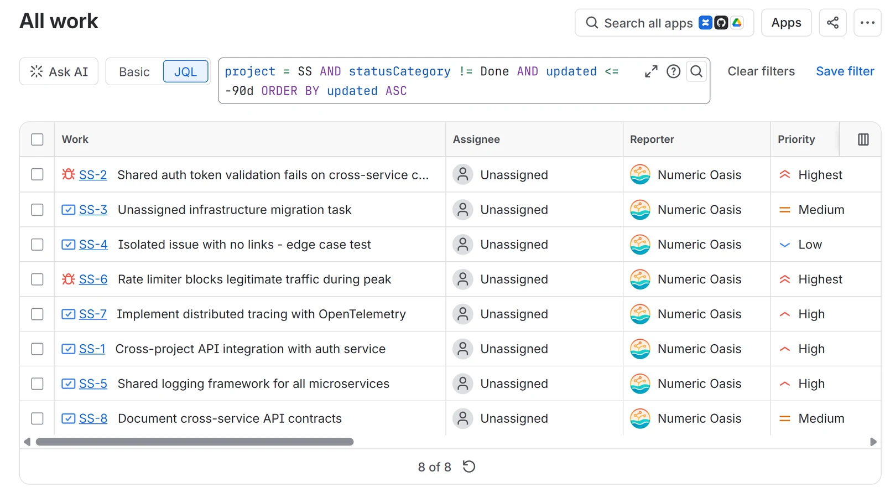

*Buscas salvas são a ferramenta de manutenção mais barata do Jira. Estas são as que vale a pena manter.*

As consultas JQL para administradores do Jira que realmente compensam não são as mais engenhosas. São um punhado de buscas simples que encontram trabalho que ninguém está acompanhando: itens de trabalho que não se mexem há meses, trabalho sem responsável, trabalho esquecido em sprints que já terminaram, trabalho de pessoas que saíram da empresa e espaços que ninguém abre mais.

Salve cada uma como filtro, olhe os resultados com uma frequência definida e entregue cada lista a quem pode decidir o que fazer com ela. Os boards continuam fiéis à realidade, e os relatórios param de contar trabalho que morreu em silêncio há um ano.

Todas as consultas abaixo usam campos e funções da [referência atual de funções JQL](https://support.atlassian.com/jira-software-cloud/docs/jql-functions/) do Jira Cloud. A Atlassian está trocando "projetos" por "espaços" e passou a chamar os antigos tíquetes de "itens de trabalho", mas o JQL mantém as palavras-chave antigas: `project` e `issuetype` continuam funcionando, e a [página de campos JQL](https://support.atlassian.com/jira-software-cloud/docs/jql-fields/) da Atlassian recomenda voltar ao termo antigo quando um novo ainda não for reconhecido.

## Quais consultas JQL um administrador do Jira precisa ter?

Uma consulta para cada tipo de abandono: trabalho parado, trabalho sem responsável, trabalho esquecido em sprints encerradas, trabalho de quem saiu, trabalho sem data de entrega ou com a data vencida, e trabalho concluído sem resolução. Rode todas uma vez por mês, ordene das mais antigas para as mais novas e mande cada lista para o líder do espaço, em vez de corrigir tudo sozinho.

Dois hábitos fazem as consultas funcionarem em qualquer espaço. Use `statusCategory` em vez de nomes de status, porque os nomes mudam de um espaço para outro, enquanto todo status pertence a uma de três categorias: To Do, In Progress ou Done. E trate os prazos (90 dias, 30 dias) como ponto de partida: uma fila de suporte envelhece muito mais rápido do que um roadmap.

## Itens de trabalho parados

```
statusCategory != Done AND updated <= -90d ORDER BY updated ASC
```

Trabalho aberto que ninguém toca há 90 dias. Acrescente `AND project = ABC` para separar por espaço e mande cada parte ao líder do espaço com três opções: fechar, devolver ao backlog ou atualizar.



## Trabalho sem responsável e trabalho órfão

```
assignee is EMPTY AND statusCategory = "In Progress"
```

Trabalho que alguém começou e que ninguém assume. Em geral o responsável saiu ou uma edição em massa limpou o campo. Atribua a quem moveu o item por último (o histórico mostra quem foi) ou devolva para To Do.

```
assignee is EMPTY AND statusCategory != Done AND created <= -30d ORDER BY created ASC
```

O backlog sem dono. Um mês sem responsável costuma significar que ninguém quer aquele trabalho; peça ao líder do espaço para fazer a triagem ou fechar.

```
issuetype = Story AND parent is EMPTY AND statusCategory != Done
```

Histórias sem item pai. O campo `parent` funciona tanto em espaços gerenciados pela equipe quanto em espaços gerenciados pela empresa. Vincule cada história ao seu epic, ou confirme que ela é mesmo independente, para que relatórios consolidados e planos consigam enxergá-la.

## Trabalho esquecido em sprints encerradas

```
sprint in closedSprints() AND sprint not in openSprints() AND sprint not in futureSprints() AND statusCategory != Done
```

Um item de trabalho pode pertencer a uma sprint concluída e a uma ativa ao mesmo tempo, por isso as duas cláusulas `not in` fazem diferença: elas deixam só o trabalho inacabado cuja última sprint fechou e que ninguém levou adiante. Mova para o backlog ou para a próxima sprint, ou feche. Se ficar como está, some do board e continua contando como aberto.

## Trabalho de pessoas que saíram

```
assignee in inactiveUsers() AND statusCategory != Done
```

```
reporter in inactiveUsers() AND statusCategory != Done
```

A função `inactiveUsers()` encontra contas desativadas, e a [base de conhecimento](https://support.atlassian.com/jira/kb/find-inactive-jira-cloud-users-without-using-third-party-apps/) da Atlassian documenta o uso dela com o responsável, o relator e outros campos de usuário. Reatribua o trabalho aberto a quem assumiu as funções da pessoa. No caso do trabalho relatado, decida quem é o dono do pedido agora, porque muitas vezes é o relator quem confirma que algo foi resolvido. As duas consultas pertencem ao checklist de desligamento, ao lado da [remoção da licença de quem saiu](/pt-BR/blog/atlassian-license-reclamation/).

## Datas de entrega ausentes e vencidas

```
duedate is EMPTY AND statusCategory != Done AND created <= -60d
```

```
duedate < startOfDay() AND statusCategory != Done ORDER BY duedate ASC
```

A primeira encontra trabalho antigo sem data de entrega. Ela só importa em espaços onde se espera uma data, então coloque esses espaços na consulta. A segunda é a lista de atrasados. Mande para os responsáveis, pedindo que concluam, remarquem ou fechem cada item, e não para a equipe inteira.

## Concluído, mas sem resolução

```
statusCategory = Done AND resolution is EMPTY
```

```
statusCategory != Done AND resolution is not EMPTY
```

Trabalho em status concluído sem resolução, e o inverso. Os dois distorcem relatórios e filtros que procuram trabalho resolvido. A causa quase sempre é uma transição do fluxo de trabalho que não preenche ou não limpa a resolução, então corrija o fluxo primeiro e depois ajuste os itens existentes em massa. Espaços de serviço gerenciados pela equipe não têm o campo de resolução; nesses, use `statusCategory`.

## Como encontrar espaços do Jira que ninguém usa?

O JQL não lista espaços parados, porque devolve itens de trabalho, e não espaços. Em vez disso, ordene a lista de espaços nas configurações de administração do Jira pela data da última atualização de item, como descreve a [base de conhecimento](https://support.atlassian.com/jira/kb/how-to-identify-inactive-projects-finding-projects-with-no-recent-issues-created-or-updated/) da Atlassian, e depois use JQL para ver o que ainda está aberto em cada espaço parado.

```
project = ABC AND statusCategory != Done ORDER BY updated ASC
```

Feche ou mova o que sobrou e então [arquive o espaço](https://support.atlassian.com/jira-cloud-administration/docs/archive-a-project/). O arquivamento de espaços está disponível nos planos Premium e Enterprise; os itens de um espaço arquivado saem dos resultados de busca, mas continuam acessíveis por link direto.

## Como transformar essas consultas em rotina?

1. **Salve cada consulta como filtro** com um prefixo comum, como "Higiene:", para que apareçam juntas.
2. **Compartilhe os filtros só com o grupo de administradores.** Alguns deles listam pessoas pelo nome.
3. **Assine os filtros.** A assinatura de filtro manda os resultados por e-mail com a frequência que você definir, e a revisão começa pela caixa de entrada, não pela memória.
4. **Separe por espaço e mande cada parte ao líder do espaço.** É ele quem sabe qual trabalho antigo ainda importa.
5. **Aplique as correções combinadas com a alteração em massa** a partir dos resultados da busca e deixe um comentário explicando o motivo, para que a próxima pessoa que abrir o item entenda o que aconteceu.

Regras de automação agendadas conseguem fazer parte disso sozinhas, mas cada execução conta contra a cota de automação do seu plano. Comece pelos filtros e só automatize as correções que você já fez à mão algumas vezes.

## Em resumo

Mantenha um pequeno conjunto de buscas JQL salvas para trabalho parado, sem responsável, órfão, esquecido em sprints, de pessoas que saíram, sem data e sem resolução. Use `statusCategory` para que funcionem em todos os espaços, revise uma vez por mês e mande os resultados para quem pode decidir. O mesmo hábito vale para a configuração: custom fields se acumulam do mesmo jeito que itens antigos, e uma [auditoria de custom fields](/pt-BR/apps/field-scout/) dá a lista equivalente para os campos.
