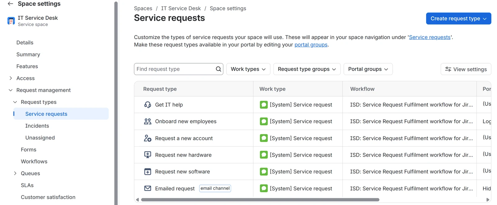

*O cliente não conhece os seus tipos de trabalho nem a estrutura da sua equipe. Ele sabe o que quebrou e do que precisa.*

Os tipos de solicitação e os formulários do JSM decidem se o cliente acha a porta certa na primeira tentativa. Tipos de solicitação são as opções que o cliente escolhe no portal, os formulários coletam os detalhes, e o portal, dentro de uma central de ajuda, é onde os dois ficam. Desenhe os três do ponto de vista do cliente.

Na prática: dê aos tipos de solicitação nomes com as palavras que o cliente usa, agrupe-os para que nenhuma lista fique longa, pergunte só o que o agente precisa para começar, esconda os campos internos que o cliente nunca deveria ver e observe algumas pessoas reais usando o portal antes de dar o trabalho por encerrado.

## O que é um tipo de solicitação no Jira Service Management?

Um tipo de solicitação é a porta de entrada do cliente num espaço de serviço: um nome, uma descrição, um ícone e um formulário de solicitação. Cada tipo de solicitação cria um item de trabalho do tipo de trabalho que você escolher, e vários tipos de solicitação podem usar o mesmo tipo de trabalho. O cliente vê tipos de solicitação; o agente vê itens de trabalho.

Você os gerencia nas configurações do espaço, em **Request management** (gerenciamento de solicitações) e depois **Request types** (tipos de solicitação). Cada um tem um grupo do portal, um formulário de solicitação (o que o cliente preenche), uma visualização do item de trabalho (o que o agente vê) e nomes voltados ao cliente para os status do workflow. Essa última parte pesa mais do que parece: um cliente que vê "Aguardando aprovação" entende melhor a situação do que um que vê "Triagem N2".

## Dê nomes do jeito que o cliente descreve o problema

O erro mais comum de portal é nomear os tipos de solicitação pela equipe ou pelo sistema que atende: "Gestão de acessos", "Suporte ERP", "Hardware N1". Um cliente com um notebook que não carrega não sabe qual deles é o dele.

Nomeie cada tipo de solicitação pelo problema ou pelo objetivo, começando com um verbo quando der:

- "Não consigo entrar" ou "Redefinir minha senha", e não "Identidade e acesso".
- "Meu notebook ou celular quebrou", e não "Incidente de hardware".
- "Pedir acesso a um sistema", e não "Solicitação de provisionamento".

Use a linha de descrição para exemplos: "Monitor, teclado, dock, celular". O cliente passa os olhos nas descrições procurando o substantivo que tem em mente.

Para achar as palavras certas, leia os resumos das últimas cem solicitações que chegaram por e-mail ou chat. Os clientes já contaram como descrevem os próprios problemas. Depois, mantenha a lista curta: cada tipo de solicitação deve existir porque tem roteamento diferente, faz perguntas diferentes ou precisa de outra meta de SLA (veja [como configurar SLA no Jira Service Management](/pt-BR/blog/jsm-sla-design/)). Se dois tipos de solicitação fazem a mesma coisa, junte-os. Se um não é usado há seis meses, aposente-o.

## Quantos tipos de solicitação cabem num grupo do portal?

Mantenha cada grupo curto o bastante para ser lido de relance. A [documentação do Data Center da Atlassian](https://confluence.atlassian.com/servicemanagementserver110/setting-up-request-types-1627463510.html) recomenda agrupar os tipos de solicitação quando o portal tem sete ou mais, e [os grupos só aparecem no portal](https://support.atlassian.com/jira-service-management-cloud/docs/organize-request-types-into-portal-groups/) quando há mais de um. Um tipo de solicitação pode estar em vários grupos, então pode aparecer onde quer que o cliente procure.

Agrupe pelo objetivo do cliente, e não pelas suas equipes: "Algo quebrou", "Pedir acesso", "Comprar ou solicitar algo", "Tirar uma dúvida". Coloque os tipos mais usados no topo de cada grupo.

## Como funcionam os formulários do Jira Service Management?

Os formulários são um construtor de formulários dentro do espaço de serviço. Quando você anexa um formulário a um tipo de solicitação, ele aparece para o cliente como parte do formulário de solicitação daquele tipo, junto com os campos do Jira já configurados. Os formulários trazem o que o formulário de solicitação simples não tem, como seções que só aparecem conforme as respostas anteriores.

Há [dois caminhos para anexar um](https://support.atlassian.com/jira-service-management-cloud/docs/add-a-form-to-the-portal-form-for-a-request-type/): abrir o tipo de solicitação e escolher **Attach form** (criar a partir de um modelo ou selecionar um formulário existente), ou abrir o formulário em **Forms**, ir a **Settings** e ativar **Attach to request types**.

Algumas regras mantêm os formulários úteis:

1. **Pergunte só o que o agente precisa para começar.** Cada pergunta extra custa tempo ao cliente e aumenta a chance de ele escolher um tipo de solicitação mais vago para fugir dela.
2. **Use seções condicionais em vez de mais tipos de solicitação.** "Qual sistema?" seguido de perguntas específicas daquele sistema é melhor do que dez tipos quase iguais.
3. **Vincule um campo do formulário a um campo do Jira quando precisar do valor em outro lugar**, por exemplo em filas, JQL, metas de SLA ou automação. Campos de formulário não vinculados aparecem abaixo dos campos do Jira, no portal e na visualização do item de trabalho.
4. **Não pergunte a mesma coisa duas vezes.** Se a pergunta está no formulário, tire o campo equivalente do formulário de solicitação.

## Esconda o que o cliente não deveria ter de responder

Alguns valores são necessários para a equipe, mas nunca deveriam ser escolhidos pelo cliente: a equipe ou o componente responsável, uma categoria para relatórios, um rótulo para automação. Na aba **Request form** do tipo de solicitação, adicione o campo e marque **Use preset value and hide from portal** (usar valor predefinido e ocultar do portal). Toda solicitação daquele tipo passa a chegar com o valor já preenchido.

Alguns campos só podem ser usados assim: Responsável, Itens de trabalho vinculados e vários campos seletores aceitam um valor predefinido, mas não podem aparecer no portal. Outros, como Tipo de trabalho, Relator, Nível de segurança e Participantes da solicitação, não podem ser adicionados a um tipo de solicitação. A Atlassian lista os dois grupos na página sobre [campos ocultos e não suportados](https://support.atlassian.com/jira-service-management-cloud/docs/what-are-hidden-fields-and-unsupported-fields-in-request-types/).

Aproveite que está no tipo de solicitação, abra os status do workflow e dê a cada status interno um nome que o cliente entenda. Vários status internos podem compartilhar o mesmo nome voltado ao cliente.

## Organize o portal a partir da central de ajuda

O cliente chega primeiro à central de ajuda, depois escolhe um portal e então um tipo de solicitação. Três decisões de layout pesam mais:

- **A página inicial da central de ajuda.** No editor atual da central de ajuda você organiza a página inicial e escolhe quais portais destacar ou ocultar. Nos planos Premium e Enterprise também é possível [criar várias centrais de ajuda](https://support.atlassian.com/jira-service-management-cloud/docs/create-and-manage-help-centers/) para públicos diferentes.
- **O nome, o texto de introdução e o logotipo de cada portal**, definidos nas configurações do espaço. Limite a introdução a uma ou duas frases sobre para que serve o portal.
- **A ordem dos grupos e dos tipos de solicitação.** As solicitações mais comuns devem aparecer sem rolar a página.

## Como testar um portal de serviço com usuários reais?

Dê a três a cinco pessoas que nunca viram o portal algumas tarefas realistas, como "Seu notebook não carrega. Peça ajuda", e observe sem ajudar. Anote qual tipo de solicitação elas abrem primeiro, onde hesitam e o que digitam. Cada primeira escolha errada é um problema de nome ou de agrupamento, não do usuário.

Um roteiro curto:

1. Escolha de cinco a oito tarefas a partir de solicitações reais do último mês.
2. Recrute testadores de fora da equipe que administra o portal.
3. Compartilhe a tela, leia cada tarefa em voz alta e fique em silêncio enquanto a pessoa trabalha.
4. Renomeie, reagrupe ou junte depois de cada rodada e teste de novo.

Depois do lançamento, acompanhe com que frequência os agentes precisam trocar o tipo de solicitação dos itens de trabalho que chegam. Um tipo de solicitação corrigido com frequência é um tipo que o cliente não entende.

## Em resumo

Dê aos tipos de solicitação o nome do problema do cliente, agrupe-os pelo objetivo dele e mantenha cada grupo curto. Use formulários para perguntas condicionais, vincule só os campos de que você precisa em outro lugar e preencha valores internos com campos ocultos predefinidos em vez de perguntar ao cliente. Organize a central de ajuda para que as solicitações comuns apareçam primeiro e observe algumas pessoas reais usando o portal antes do lançamento e depois de cada grande mudança. Se quiser ajuda para redesenhar um portal existente, a [equipe Atlassian da Numeric Oasis](/pt-BR/atlassian/) faz esse tipo de trabalho de gestão de serviços.
