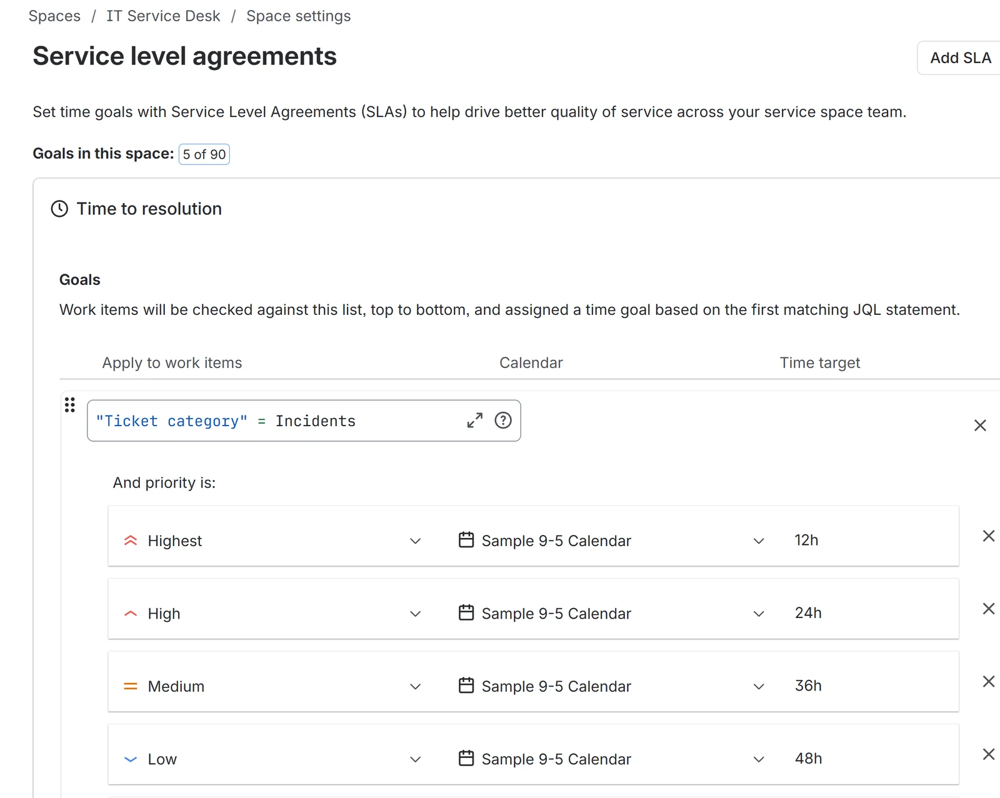

*Um relatório de SLA todo verde e um cliente irritado podem existir ao mesmo tempo. Quando isso acontece, o SLA está medindo a coisa errada.*

Configurar SLA no Jira Service Management é montar um cronômetro com três regras (quando começar a contar, quando pausar, quando parar), mais uma meta e um calendário para cada grupo de solicitações. Um bom SLA faz esse cronômetro acompanhar a espera que o cliente realmente vive, e não a espera que é conveniente relatar.

Tudo se resume a quatro decisões: quais eventos iniciam e encerram a contagem, quais pausas são legítimas, qual calendário vale e qual meta se aplica a cada solicitação. Com elas certas, o relatório de SLA vira algo em que dá para agir. Com elas erradas, o relatório continua verde enquanto a fila cresce.

## Como funciona um SLA no Jira Service Management?

Um SLA mede o tempo de um item de trabalho entre uma condição de início e uma condição de fim, com pausas opcionais no meio, e compara esse tempo com uma meta. Cada meta vale para os itens de trabalho que a sua JQL encontra e só conta tempo dentro do horário de trabalho do seu calendário.

Os SLAs ficam nas configurações do espaço de serviço, em **Request management** (gerenciamento de solicitações) e depois **SLAs**. Cada SLA tem três partes:

- **Condições.** "Start counting time when" (começar a contar quando), "Pause counting time when" (pausar quando, opcional) e "Finish counting time when" (terminar quando). Cada uma aceita um ou mais eventos, como Issue Created, Entered Status, Comment: For Customers ou Resolution: Set. Várias condições de início significam "qualquer uma delas".
- **Metas.** Linhas de JQL, cada uma com um tempo-alvo e um calendário. Os itens de trabalho são comparados com as metas de cima para baixo.
- **Calendários.** Dias úteis, faixas de horário, feriados e fuso horário. Calendários novos [vêm com 09:00 às 17:00 por padrão](https://support.atlassian.com/jira-service-management-cloud/docs/set-up-sla-calendars/).

A maioria dos espaços de serviço começa com SLAs como Time to first response e Time to resolution. Trate esses SLAs como ponto de partida, não como projeto pronto.

## Início e fim: meça o que o cliente está esperando

Faça uma pergunta por SLA: o que o cliente está esperando, e em que momento ele para de esperar?

- **Time to first response** (tempo até a primeira resposta) deve começar quando a solicitação é criada e parar quando alguém da equipe escreve para o cliente: Comment: For Customers. Uma nota interna ou uma troca de responsável não é resposta, porque o cliente nunca vê.
- **Time to resolution** (tempo até a resolução) deve parar quando o cliente recebe o resultado, normalmente em Resolution: Set ou ao entrar num status de resolvido. Se o seu workflow tem um status como "Resolvido, aguardando confirmação", decida se o cliente ainda está esperando ali. Normalmente não está.

Não pare um cronômetro voltado ao cliente com algo que só a equipe enxerga, como mover o item de trabalho para Em andamento. Isso mede a velocidade da triagem. Vale medir a triagem, mas num SLA próprio, e não com o nome de "resposta".

## Quando um SLA deve pausar?

Pause um SLA só enquanto o próximo passo está com o cliente, normalmente quando o item de trabalho entra num status como Waiting for customer (aguardando cliente) depois que um agente fez uma pergunta concreta. Não pause por nada que dependa do seu lado, como esperar outra equipe ou um fornecedor: isso esconde justamente o atraso que o cliente sente.

A pausa também é a parte mais abusada do desenho de SLA. Quando Waiting for customer para o relógio, surge um incentivo silencioso para mandar itens de trabalho para lá com uma pergunta vaga. Três proteções ajudam:

1. Exija um comentário visível ao cliente na transição para Waiting for customer, por exemplo com uma tela de transição em que o comentário é obrigatório.
2. Devolva o item de trabalho automaticamente quando o cliente responder, com uma regra de automação disparada por comentário do cliente, para o relógio voltar a correr sem depender da memória de ninguém.
3. Acompanhe o tempo pausado. Uma equipe cujos itens de trabalho passam mais tempo pausados do que em atendimento merece uma conversa.

Se você quer enxergar o tempo de espera por outra equipe ou por um fornecedor, crie um SLA separado para isso em vez de escondê-lo dentro do SLA do cliente.

## Calendários: conte só as horas em que alguém poderia ter trabalhado

Uma meta de quatro horas significa uma coisa às 16:00 de sexta-feira e outra às 09:00 de terça. Crie um calendário para cada escala de atendimento que você realmente cobre, cada um com seu fuso horário e seus feriados, e associe-o às metas a que se aplica. Se incidentes críticos têm plantão 24/7 e todo o resto é horário comercial, são duas metas com dois calendários, e não um meio-termo.

Confira se todo calendário tem dias úteis definidos. A [base de conhecimento da Atlassian](https://support.atlassian.com/jira/kb/slas-are-being-paused-as-soon-as-they-have-started/) descreve SLAs que pausam assim que começam porque a semana de trabalho do calendário ficou vazia.

## Uma única meta de SLA deve valer para todas as solicitações?

Não. Uma meta única ou define um alvo que as solicitações urgentes estouram, ou um alvo tão folgado que as rotineiras sempre cumprem. Divida as metas pelo que muda a expectativa do cliente, normalmente prioridade, tipo de solicitação ou os dois, e mantenha uma meta genérica no fim da lista.

Um SLA de Time to resolution poderia ficar assim, de cima para baixo:

```
issuetype = Incident AND priority = Highest   -> 4h, calendário 24/7
issuetype = Incident                          -> 16h, horário comercial
issuetype = "Service Request"                 -> 24h, horário comercial
Todos os itens de trabalho restantes          -> 40h, horário comercial
```

A ordem importa porque vale a primeira meta que corresponder, então coloque a JQL mais específica no topo. Também dá para agrupar várias prioridades numa meta só, e a Atlassian observa que [uma meta agrupada continua contando como uma meta](https://support.atlassian.com/jira-service-management-cloud/docs/use-priority-to-group-sla-goals/), o que ajuda se você estiver perto do limite de metas. Quando a prioridade de um item de trabalho muda, o cronômetro recalcula o tempo restante pela meta da nova prioridade.



## As armadilhas que deixam o relatório de SLA enganoso

- **Medir a resolução de trabalho sem dono.** Se os itens de trabalho esperam sem responsável numa fila compartilhada, o Time to resolution mede a fila, não a equipe. Acrescente um SLA curto de tempo até a atribuição (começa em Issue Created, termina em Assignee: From Unassigned) para ver onde a espera realmente está.
- **Parar num evento que você não pretendia.** Resolution: Set também dispara quando uma regra de automação fecha solicitações paradas. Decida se esses fechamentos devem contar como meta cumprida.
- **Ignorar solicitações reabertas.** Um item de trabalho reaberto inicia um novo ciclo de SLA. A função JQL `breached()` [olha só o último ciclo](https://support.atlassian.com/jira-service-management-cloud/docs/jql-functions/), enquanto `everBreached()` pega uma violação em qualquer ciclo. Use a segunda nos relatórios sobre a experiência do cliente.
- **Mudar as regras sem registro.** Anote com data cada mudança de SLA, para que um salto nos números no próximo trimestre possa ser lido à luz dela.

## Como montar relatórios de SLA no Jira Service Management?

Use duas ferramentas. A página de relatórios do espaço de serviço mostra tendências, como a porcentagem de cada SLA cumprida por semana, filtrada por tipo de solicitação. Filtros JQL com funções de SLA mostram o trabalho ao vivo, como itens prestes a estourar. A primeira diz se o desenho funciona; a segunda diz aos agentes o que pegar em seguida.

Alguns filtros úteis (troque os nomes dos SLAs pelos seus):

```
"Time to first response" < remaining("2h")
"Time to resolution" = everBreached()
"Time to resolution" = paused()
"Time to resolution" >= remaining("0h") AND "Time to resolution" = running()
```

Coloque o primeiro numa fila ou num dashboard para os agentes. Revise os outros todo mês por tipo de solicitação e procure dois padrões: metas sempre cumpridas com muita folga e metas sempre estouradas. Os dois indicam que a meta ou as condições precisam de ajuste. Se JQL ainda não faz parte da sua rotina, comece por estas [consultas JQL para administradores](/pt-BR/blog/jira-jql-queries-for-administrators/).

## Em resumo

Desenhe cada SLA em torno do que o cliente está esperando: comece quando ele pede, pause só enquanto o próximo passo é dele e pare quando ele recebe o que precisava. Use calendários que correspondam às escalas que você realmente cobre, divida as metas por prioridade ou tipo de solicitação com a JQL mais específica primeiro, acrescente um SLA de tempo até a atribuição para expor o trabalho sem dono e acompanhe o tempo pausado e os ciclos que já estouraram, não só a porcentagem principal. Se quiser uma segunda opinião sobre um espaço de serviço existente, a [equipe Atlassian da Numeric Oasis](/pt-BR/atlassian/) revisa esse tipo de configuração.
